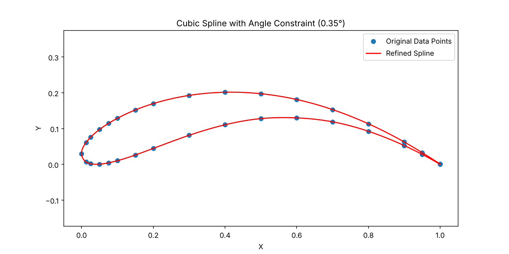
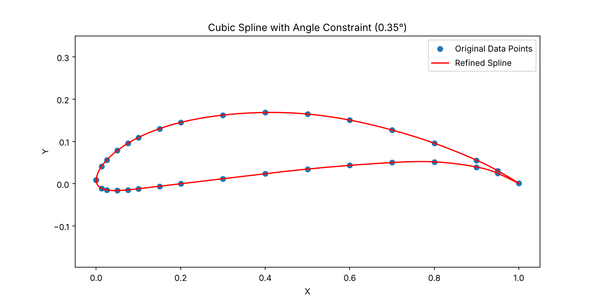

# Rear-wing airfoil reconstruction

Coordinates for the Benzing race-car profiles used on the rear wing (Be 122-185 mainplane, Be 153-105 flaps) aren't published as usable CAD-ready files. These scripts take a sparse set of coordinates and rebuild a smooth, densely sampled profile for CAD and meshing.

**How it works:** [`interp.py`](interp.py) fits a cubic spline through the raw points, samples it finely, then keeps only the points needed so that no two neighbouring segments turn by more than `MAX_ANGLE_DEG` (0.35° by default). Points cluster at the leading and trailing edges, where curvature is high, and thin out on the flat mid-chord.

| Input | Output |
|---|---|
| [`profiles/Be122-185.asc`](profiles/Be122-185.asc) | [`profiles/Be122-185_interpolated.txt`](profiles/Be122-185_interpolated.txt) |
| [`profiles/Be153-105.asc`](profiles/Be153-105.asc) | [`profiles/Be153-105_interpolated.txt`](profiles/Be153-105_interpolated.txt) |

 

## Usage

You need Python with `numpy`, `scipy` and `matplotlib` (`pip install numpy scipy matplotlib`). There are three ways to run it:

1. Drag an airfoil file onto `interp.bat`
2. Double-click `interp.bat` and type the file name
3. From a terminal: `python interp.py profiles/Be122-185.asc`

It reads plain two-column `x y` files (`.txt`, `.dat`) as well as CAD-style `.asc` files written as `X <x> Y <y> Z <z>`, where the profile lies in the X-Z plane. Output goes to `<name>_interpolated.txt`, with a preview plot saved as `<name>_interpolated.png`.
